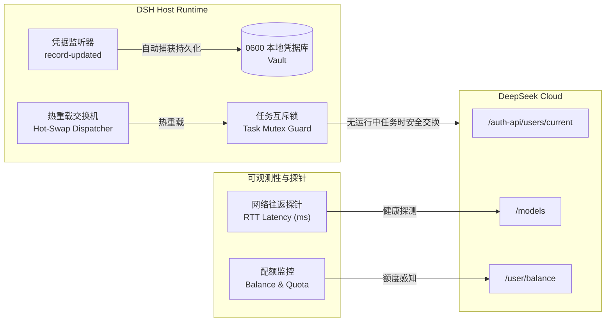

# DeepSeek Harness Account Switcher (@local/account-switcher)

> **面向 SRE / 运维人员的 DeepSeek Harness 运维级多账号高可用平滑切换与凭据治理插件。**  
> *DevOps & SRE-grade multi-account high-availability failover and credential governance plugin for DeepSeek Harness (DSH).*

[](https://github.com/keerzzz/dsh-account-switcher/blob/main/LICENSE)
[](https://github.com/keerzzz/dsh-account-switcher)
[](https://github.com/deepseek-ai)

[English](#english) | [中文说明](#中文说明)

---

## 中文说明

在高频次调用大模型、多 Agent 并发或自动化开发场景下，单一 DeepSeek 账号常面临**配额消耗过快、触发 API 频率限制（Rate Limit / 429）或突发服务降级**的痛点。

本插件以 **SRE / 运维可观测性与高可用容灾思维** 为核心设计理念，为 DeepSeek Harness 提供零停机热切换、任务并发保护、端到端延迟探测、实时配额监控与自动化凭据治理能力。

### 🛠️ 运维与 SRE 设计特性



1. **高可用主备故障转移与零停机热重载 (HA & Zero-Downtime Hot-Swapping)**
   - 通过重写底层 Platform Grant，实现毫秒级会话切换。
   - 下一次模型调用即刻生效，无需重启 DSH 进程，保障大模型任务流的持续性。

2. **会话互斥安全保护锁 (Session Mutex & Task Concurrency Guard)**
   - 切换前主动检查 `agents.list()` 中正在执行的任务数。
   - 若当前账号仍有并发工作任务，拒绝切换，严防会话漂移导致任务状态损坏。

3. **端到端网络延迟与可用性探针 (Active Latency Probing)**
   - 双向主动探针校验：平台用户状态（`/auth-api/v0/users/current`）+ 模型能力握手（`/models`）。
   - 实时测量各账号端到端网络往返延迟（RTT ms），为多账号最优路由提供量化指标。

4. **资源容量与配额可观测性 (Quota & Balance Observability)**
   - 直连官方资金接口（`/user/balance`），展示总余额、赠金（Granted）、充值金（Topped-up）及货币种类。
   - 支持单卡片一键“刷新余额”，及时掌握配额水位，防患额度耗尽突发故障。

5. **凭据生命周期与健康自愈 (Credential Hygiene & Self-Healing)**
   - **登录自愈**：全自动捕获新登录凭据，热写入 Vault，杜绝人工误操作导致凭据遗失。
   - **一键全量测活**：并发测试库内全部账号健康度，自动标记失效凭据。
   - **故障熔断剔除**：一键清理（Prune）全部失效账号，保持凭据池的高可用与整洁。

6. **零信任本地隔离与合规 (Zero-Trust Local Security)**
   - 凭据仅存储于宿主机受保护的凭据库（0600 权限），绝不上云、不外发任何第三方，符合企业级安全基线。

7. **运维批处理与多环境镜像导入/导出 (Batch Operations)**
   - **批量导入**：支持标准制表符行（`账号\tToken`）、纯 Token 列表、对象数组 JSON、字典映射等全形态输入。
   - **备份与迁移**：支持导出为 TSV、JSON、Tokens 纯列表，方便集群化多机镜像同步。

---

## English

In intensive LLM agent development and automated CI/CD workflows, relying on a single DeepSeek account frequently leads to **quota exhaustion, rate-limiting (HTTP 429), or service degradation**.

This plugin is architected from an **SRE and operational resilience perspective**, introducing zero-downtime hot-swapping, concurrency task guards, live latency probing, quota observability, and automated credential hygiene into DeepSeek Harness.

### 🛠️ DevOps & SRE Highlights

1. **Zero-Downtime Credential Hot-Swapping**
   - Swaps stored platform grants in memory without restarting the DSH process.
   - The subsequent model turn immediately uses the new credential.

2. **Task Concurrency Guard (Session Mutex)**
   - Inspects running agent tasks before executing a switch.
   - Refuses switching if tasks are actively bound to the current credential, preventing session race conditions.

3. **Active Latency & Availability Probing**
   - Two-way active probing via `/auth-api/v0/users/current` and `/models`.
   - Displays live round-trip network latency (RTT in ms), allowing operations teams to route requests via the fastest credentials.

4. **Resource Quota & Balance Observability**
   - Integrates directly with official endpoints (`api.deepseek.com/user/balance`).
   - Tracks total, granted, and topped-up amounts across currencies (CNY/USD).

5. **Automated Credential Hygiene & Pruning**
   - **Auto-Persistence**: Listens to `credentials/record-updated` and persists newly signed-in accounts into the local vault automatically.
   - **Concurrent Health Check**: Probes all credentials in parallel with pass/fail metrics.
   - **Pruning Circuit Breaker**: One-click cleanup of expired/invalid accounts.

6. **Zero-Trust Local Security**
   - Credentials reside exclusively within the local encrypted vault (0600 file permissions). No credentials ever leave your host.

7. **Multi-Format Batch Import & Backup**
   - Supports delimited text (`name\ttoken`, `phone:token`), bare tokens, and standard JSON formats.
   - One-click export to TSV, JSON, or token lists for cross-machine migration.

---

### 📦 安装与启用 (Installation)

```bash
# 1. 克隆本插件到 DSH profiles 模块目录
git clone https://github.com/keerzzz/dsh-account-switcher.git ~/.dsh/profiles/web/node_modules/@local/account-switcher

# 2. 在 DSH 配置文件 cordis.yml 中确认加载:
# - id: account-switcher
#   name: '@local/account-switcher'

# 3. 重启 DSH 服务即可在设置面板中体验
pnpm dsh web
```

---

### 📄 License

[MIT License](LICENSE) © 2026 [keerzzz](https://github.com/keerzzz)
